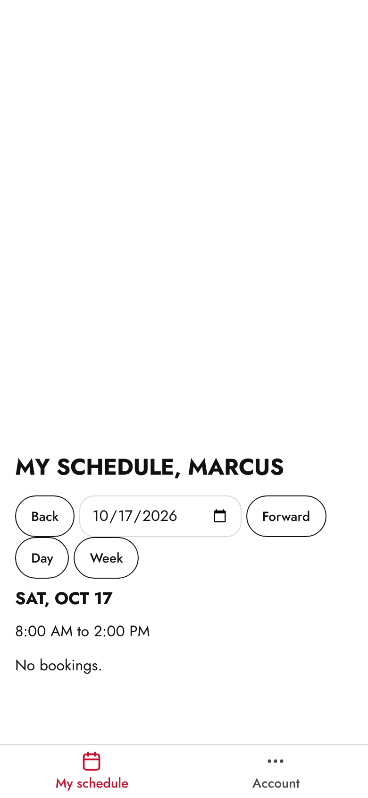

# Barber guide

One page for the chairs. Everything is at **yoursite/admin** on your phone.

## Sign in

1. Open **yoursite/admin** and tap **Sign in**.
2. Use the email and the temporary password Dontrise sent you.
3. The first time, choose your own password: 12 characters or more, not a
   word people could guess. You cannot see anything else until you do.

## See your schedule

**My schedule** is your first screen. It shows your day: each client, the
time, the services and the price. Use the date to look at another day.

You only see your own chair. Nobody else's bookings show here.

## Mark a client done

1. Tap the client on your schedule.
2. Tap **Completed** when they are done, or **No show** if they never came.
3. Pressed the wrong one? Tap **Undo** in the message at the bottom right away.

If Dontrise has turned it on for you, you can also block time on your own
chair from **My schedule**.

## Change your password

Tap **Account** at the bottom, fill in **Current password** and **New
password**, then **Change password**. Lost your phone? **Sign out on every
device** signs you out everywhere.

## Something wrong?

Tell Dontrise first. For the website itself, Visualize:
**contact@visualizeclients.com**
