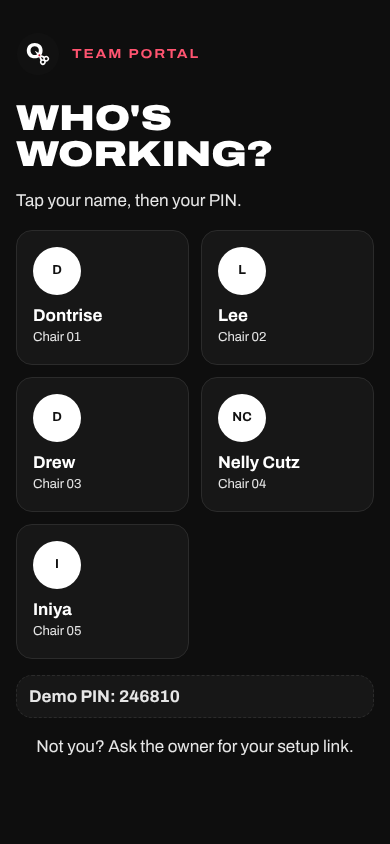
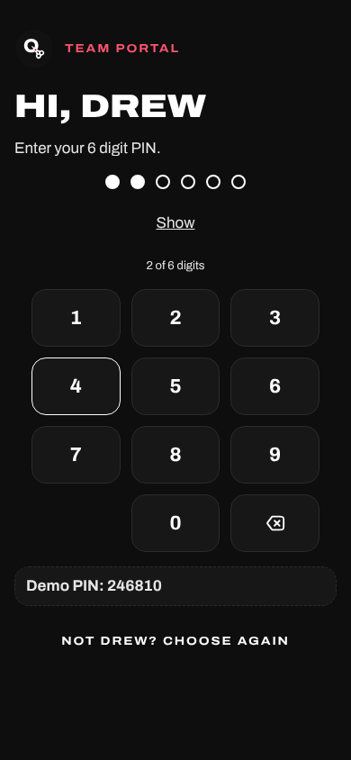
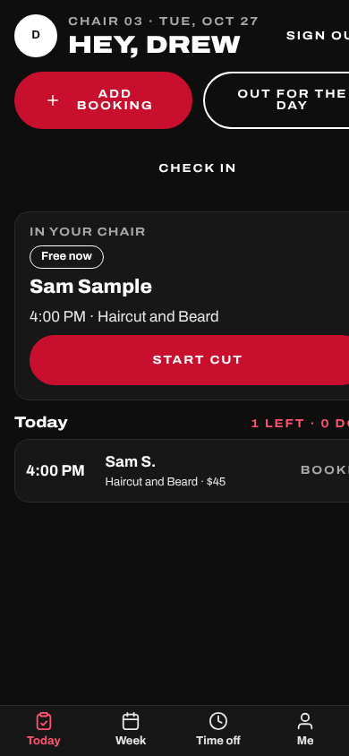
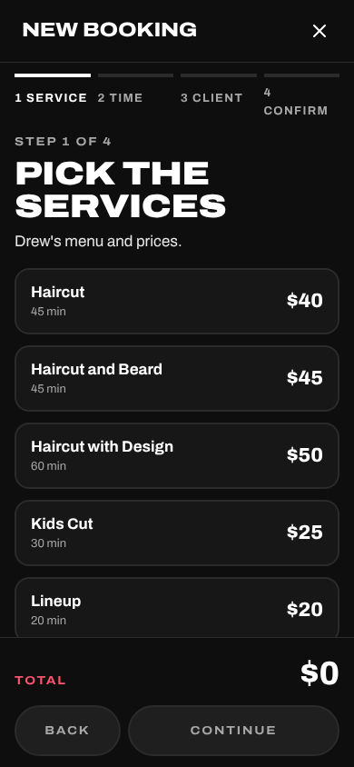
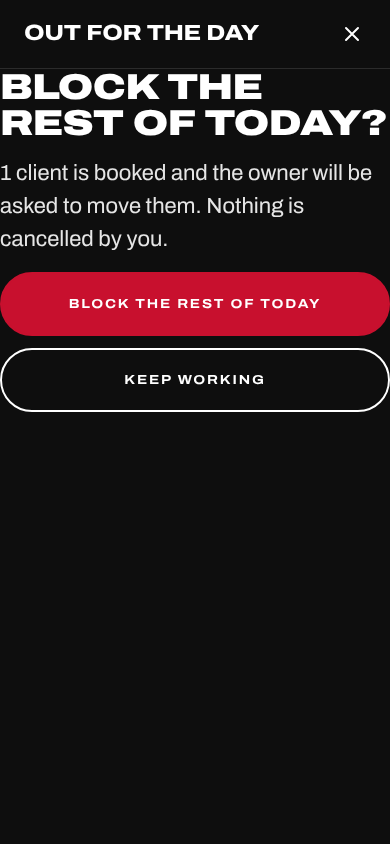
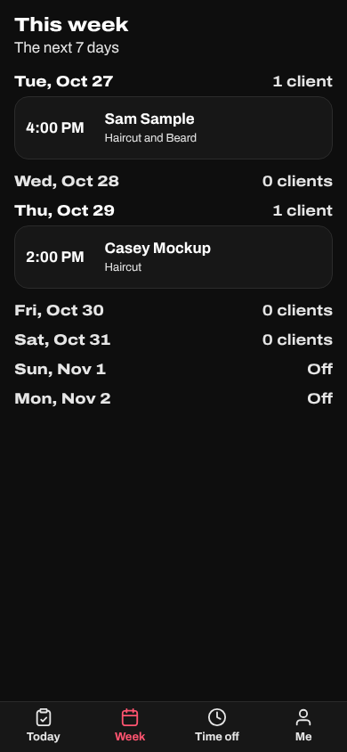
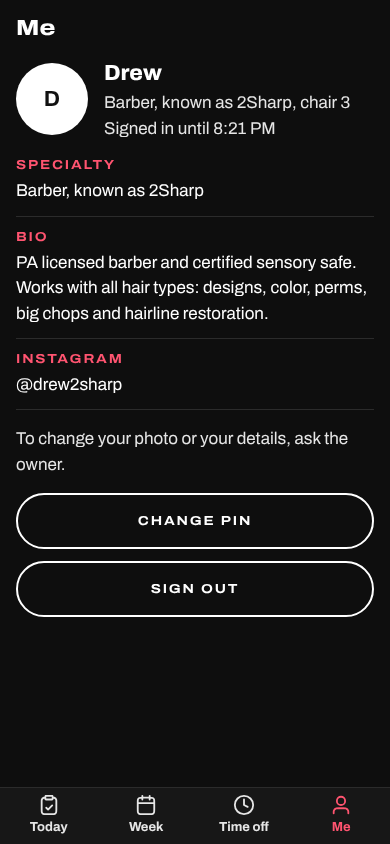

# Barber guide

One page for the chairs. Everything is at **yoursite/team** on your phone. There
is one shared address for the whole shop: you tap your card, then your PIN.

## 1. First time: choose your PIN

1. Dontrise sends you a setup link. Open it on your phone.
2. Tap six digits for your PIN, then the same six again to confirm.
3. You are signed in. The link works once and stops after 72 hours; ask Dontrise
   for a new one if it does not.

Pick digits that are not your birthday or 123456. Nobody, including Dontrise,
can see your PIN. If you forget it, Dontrise taps **Reset PIN** and sends a new link.

## 2. Sign in

1. Open **yoursite/team**. The screen asks **Who's working?** and shows a card for
   each chair: your initials (or your photo), your name and your chair number.
2. Tap your card.
3. Tap your six digits on the big pad. It signs in on the sixth. **Show** prints the
   digits in place of the dots if you want to check them; **Hide** puts the dots back.

Five wrong PINs lock you out for 15 minutes. Dontrise can unlock you sooner.
You stay signed in for up to 12 hours.

## 3. Today, your home screen

The top says your chair and the date and greets you by name. **Sign out** is in the
corner. Under it are your two big buttons, **Add booking** (red) and **Out for the
day**, and a smaller **Check in**.

**In your chair** is the card that matters:

- A cut going on shows the client, the service, the price and when it started, with
  **Done** and **No show**.
- A free chair with a walk-in waiting for you shows **Walk-in #2: Tony B.** with how
  long they have waited and a red **Start cut**. Tap it when they sit down: the cut
  starts right now.
- A free chair with your next booked client shows them with **Start cut** too. Tap it
  when they are in the chair: it marks them arrived and started.
- Nobody waiting: **Free now**, and a line saying so.

**Today** lists your clients in time order: the time, the first name and last
initial, the service and price, and a tag (Booked, Walk-in). Done and no show rows
sit at the bottom, greyed. Tap any row to read notes or add one. You never see a
phone number or email: **Call shop** in the row's panel reaches the desk.

The screen refreshes itself every 30 seconds while it is open, and right after
anything you tap.

## 4. Add a booking, or a walk-in

1. Tap **Add booking**. The full-screen flow opens on your chair only.
2. Tap the services (your own prices show), then **Continue**.
3. **Now** is already picked: that is a walk-in starting this minute. Tap a day and a
   time instead for someone booking ahead. Now is only offered while the shop is open
   and you are in; outside your hours the tile says why.
4. Type the name and a phone number (the shop keeps it for their records), then
   **Continue** and **Confirm**.

If your chair is free, the client lands **In your chair** right away. If you are in a
cut, they join the walk-in line and the ticket says their place and the wait.

## 5. Done, no show, undo

On **In your chair**, tap **Done** when they are finished, or **No show** if they
never came. A message offers **Undo** for a few seconds. Finishing early gives the
rest of that time back, so the next walk-in can start straight away.

## 6. Out for the day

Tap **Out for the day**. A full-screen question says how many clients are booked and
that Dontrise will be asked to move them. **Block the rest of today** does it;
**Keep working** backs out. Your booked clients stay booked until Dontrise decides,
client by client. You never cancel anyone yourself.

## 7. Week and time off

**Week** shows each day with how many clients you have; tap a day to open it.
**Time off** holds **Block time** (a break or leaving early) and **Days off ahead**.
Days with no clients save straight away; days with clients go to Dontrise as a
request.

## 8. Me

**Me** shows your specialty, bio, Instagram and chair, **Change PIN** (it asks for
your current PIN first) and **Sign out**. To change your photo or your details, ask
Dontrise. A gallery photo he credits to you shows on your page too.

## 9. The check-in tablet

If the front desk tablet is signed in as you, **Check in** opens the big screen for
clients: **Walk in** books them through the same flow, **I have an appointment** finds
today's bookings on your chair by name or the last 4 of their phone, and one tap
marks them arrived. **Exit** comes back to Today.

## Something wrong?

Tell Dontrise first. For the website itself, Visualize:
**contact@visualizeclients.com**
