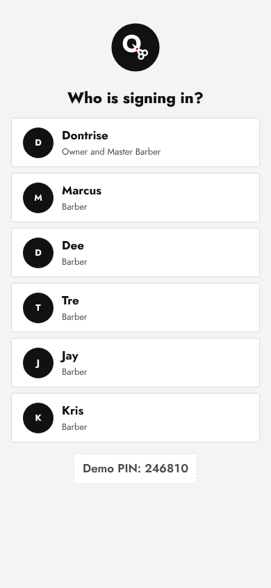
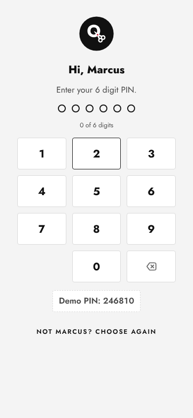
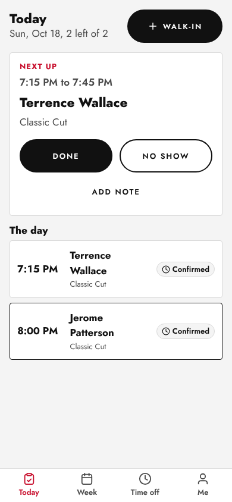
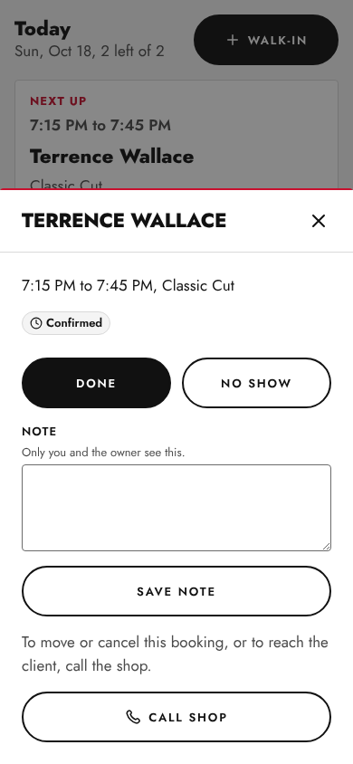
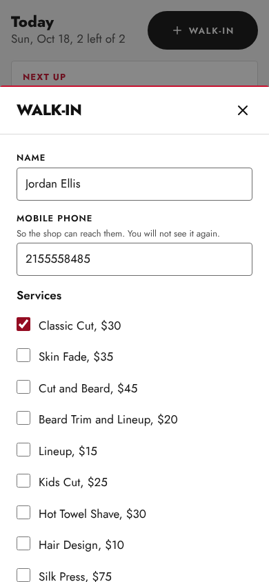
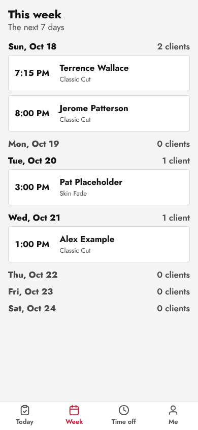
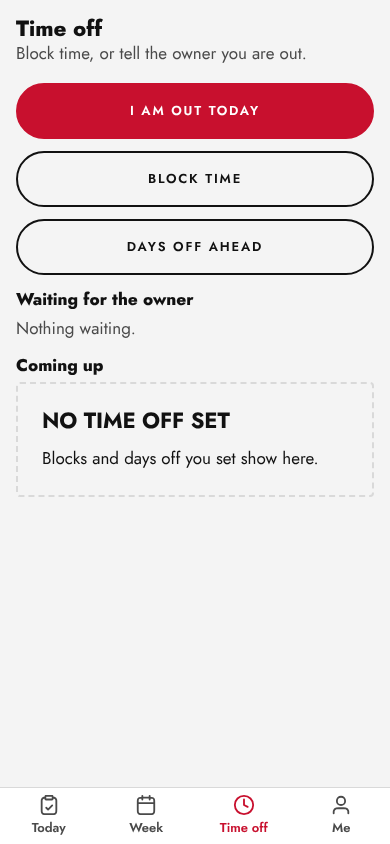
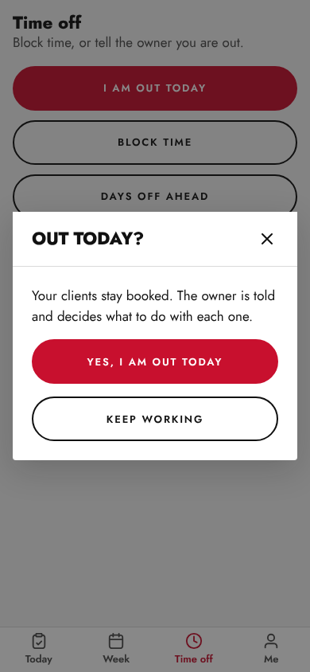
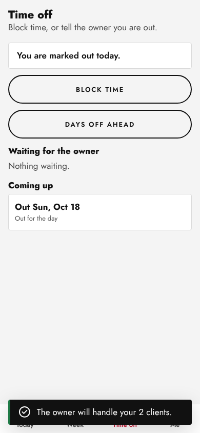
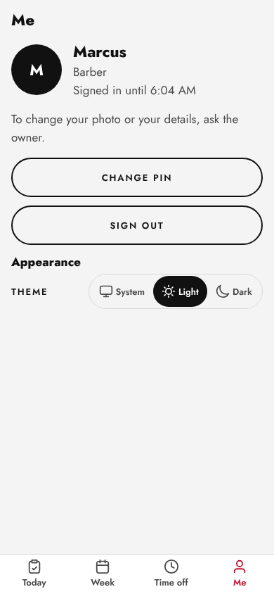

# Barber guide

One page for the chairs. Everything is at **yoursite/team** on your phone. There
is one shared address for the whole shop: you tap your name, then your PIN.

## 1. First time: choose your PIN

1. Dontrise sends you a setup link. Open it on your phone.
2. Tap six digits for your PIN, then the same six again to confirm.
3. You are signed in. The link works once and stops after 72 hours; ask Dontrise
   for a new one if it does not.

Pick digits that are not your birthday or 123456. Nobody, including Dontrise,
can see your PIN. If you forget it, Dontrise taps **Reset PIN** and sends a new link.

## 2. Sign in

1. Open **yoursite/team**.
2. Tap your name.
3. Tap your six digits. It signs in on the sixth.

Five wrong PINs lock you out for 15 minutes. Dontrise can unlock you sooner.
You stay signed in for up to 12 hours.

## 3. Read your day

**Today** shows **Next up** at the top, then the rest of your day. You only see your
own chair. You see the client's name, the services, the time and any notes. You
never see a phone number or email: tap **Call shop** if you need one.

## 4. Mark a client done or a no show

1. On **Next up**, tap **Done** when they are finished, or **No show** if they never came.
2. A message offers **Undo** for a few seconds. Tap it if you pressed the wrong one.
3. Tap a client in the list to open them, read notes, or tap **Add note**.

## 5. A walk-in

1. Tap **Walk-in** (top right of Today).
2. Type the name and a phone number (the shop keeps it for their records), and tick the services.
3. Tap **Start now**. The chair shows busy for that time.

## 6. See the week

Tap **Week**. Each day shows how many clients you have. Tap a day to open it.

## 7. Out today, or time off

Tap **Time off**.

1. **I am out today**: tap it, then **Yes, I am out today**. Your booked clients
   stay booked. The owner is told and decides, client by client, whether to move
   them to another chair or cancel. You do not cancel anyone yourself.
2. **Block time**: for a break or leaving early. If a client is booked in that
   time you are told to call the shop.
3. **Days off ahead**: pick the days. If you have no clients then, it is saved
   straight away. If you do, it goes to the owner as a request.

A short recording of this flow is in `docs/screens/p11/recordings/barber-flow.webm`.

## 8. Me: change your PIN, theme, sign out

Tap **Me**. **Change PIN** asks for your current PIN first. You can switch light
or dark. **Sign out** ends your session on this phone. Photos are the owner's job:
ask Dontrise.

## Something wrong?

Tell Dontrise first. For the website itself, Visualize:
**contact@visualizeclients.com**
