# Owner guide

For Dontrise. This is how to run the shop's website and bookings from your
phone. Everything here happens at **yoursite/admin** (the address Visualize gave
you). If something looks wrong, the last page says who to call.

## Signing in and changing your password

1. Open **yoursite/admin** on your phone and tap **Sign in**.
2. Type your email and password. Tap **Sign in**.
3. The first time, the site asks you to choose a new password. Pick one with
   at least 12 characters that is not a word people could guess.
4. To change it later: tap **More** at the bottom, then **Account**, then fill
   in **Current password** and **New password** and tap **Change password**.
5. Lost your phone? On Account, tap **Sign out on every device**. Then sign in
   again on the phone you have.

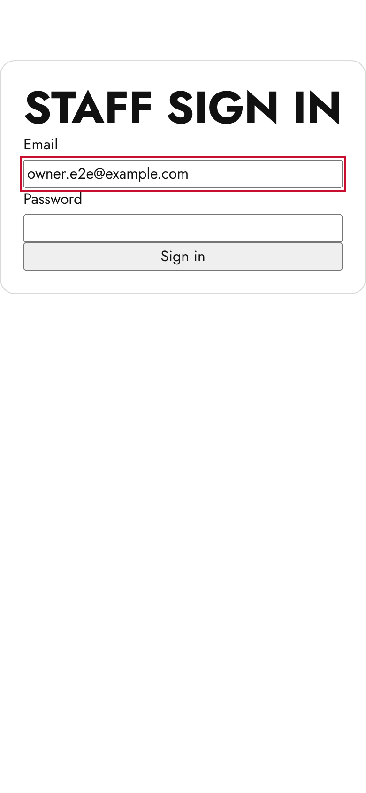

## Reading Today

Today is the first screen after you sign in. Across the top: how many chairs
are booked today, how many bookings, how many are done, and the money expected.
**New online bookings** shows how many people booked on the website since you
last looked. Tap it to see them.

Below that, one card per chair. **Now** is who is in the chair right now.
**Next** is who is coming after. Tap a name to see the booking.

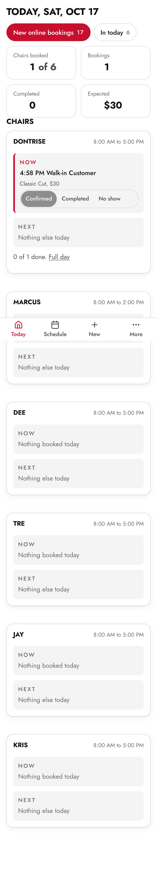

## Marking a client done or a no show, and undo

1. On Today, find the client on the chair card.
2. Tap **Completed** when they are done, or **No show** if they never came.
3. A small message appears at the bottom with **Undo**. Tap it within a few
   seconds if you pressed the wrong one.

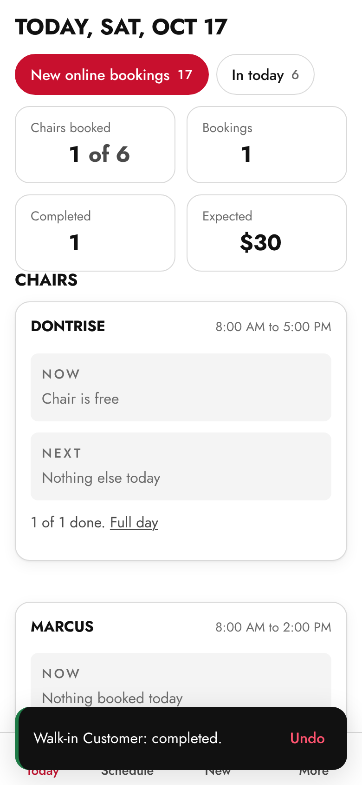

## Adding a walk-in or a phone booking

1. Tap **New** at the bottom.
2. Pick **Walk-in** for someone standing in the shop (it starts now) or
   **Phone booking** for someone who called (you choose the day and time).
3. Tick the services, pick the chair, type the name and phone.
4. Tap **Book it**. Tick **Email the customer a confirmation** first if they
   gave an email and want one.

A phone booking follows the same rules as the website. If the time is too
soon or outside hours, tick **Allow inside the lead time or past the booking
window** to take it anyway.

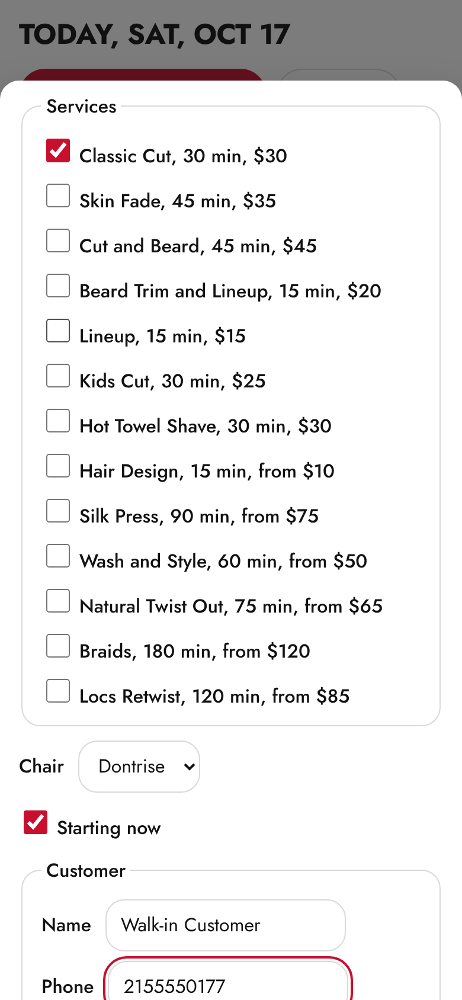

## Blocking time and taking a day off

To block an hour (lunch, a break, a walk-in you want to protect):

1. Tap **Schedule** at the bottom, then **Block time**.
2. Pick the chair, the day, from and to. Add a reason if you like (only staff
   see it). Tap **Block this time**.

To take a whole day off, or mark someone off for the day:

1. Tap **More**, then **Who's in**.
2. Next to the barber, choose **Off today**. Choose **In** to put them back.

For a day the whole shop is closed: **More**, **Settings**, **Closures**, add
the date.

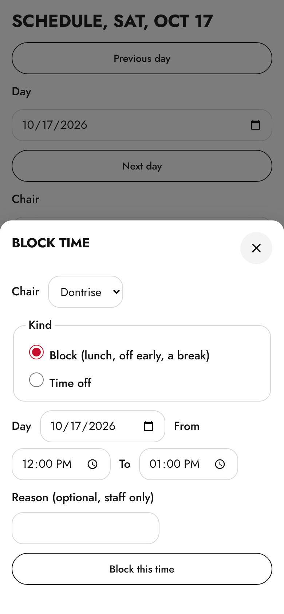

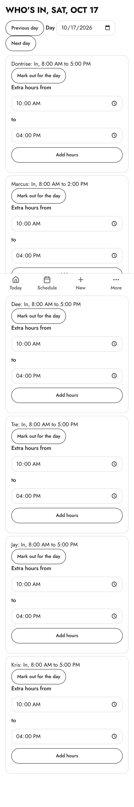

## When a change clashes with bookings (Keep or Cancel)

If you block time, mark someone off, change hours or remove a service and a
booking already sits in that spot, the site stops and lists each booking it
would affect. For each one, choose:

- **Keep as an exception**: the booking stays exactly as it is.
- **Cancel, do not tell the customer**: for walk-ins and people you have
  already spoken to.
- **Cancel and email the customer**: the customer gets an email with a link to
  pick a new time.

Nothing is changed until you choose for every booking in the list and tap the
button at the bottom.

## Editing services, prices and hours

1. Tap **More**, **Settings**. Services is the first tab.
2. Tap **Edit** next to a service to change its name, price, minutes or
   whether it can be booked online. **Add a service** adds a new one.
3. Prices with "from" show "From $40" on the website.
4. **Hours** is the next tab: the shop's opening hours for each day. Each barber
   has their own hours under **Staff**, on their card.

Removing a service keeps it on past bookings; the site asks about any future
bookings that use it (see Keep or Cancel above).

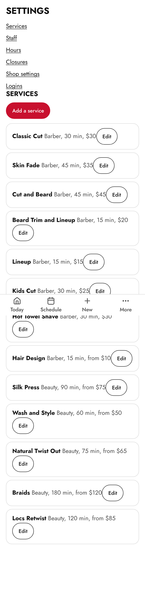

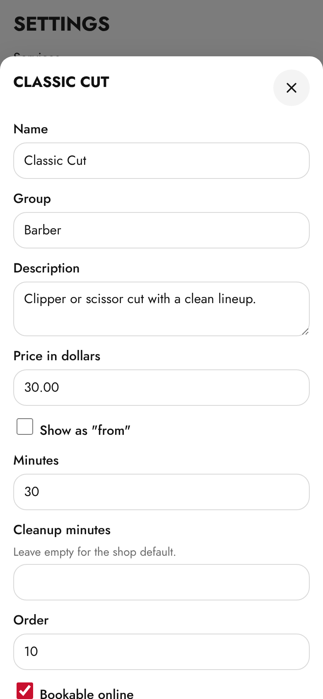

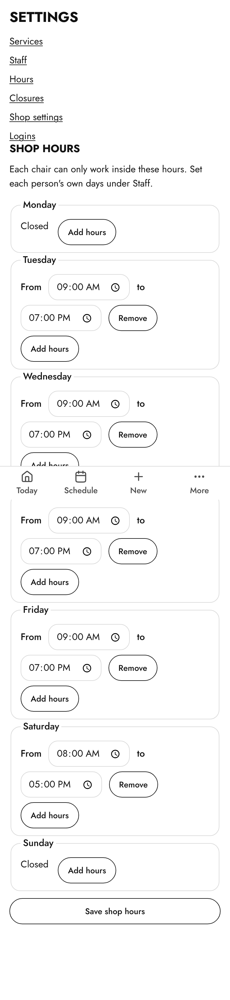

## Adding a barber and their login

1. **More**, **Settings**, **Staff**, then **Add a staff member**. Type the
   name, the role, what they are known for, and the chair number. Tick
   **Show on the website** when they are ready to be seen.
2. Set their hours on their card.
3. Give them a login: **Settings**, **Logins**, **Create login**. Choose the
   staff member and type their email. The site shows a temporary password
   **once**. Send it to them. They must change it the first time they sign in.
4. If they forget the password: **Logins**, **Reset password**, and send them
   the new temporary one. **Disable** a login the day someone leaves.

The web address of each barber's page (yoursite/chairs/name) never changes,
even if you rename them, so printed cards keep working.

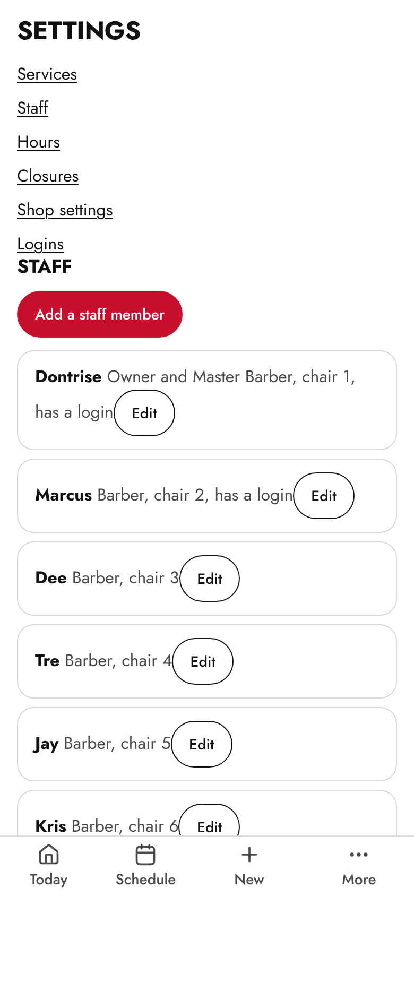

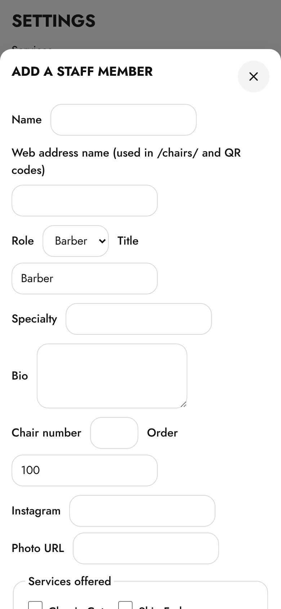

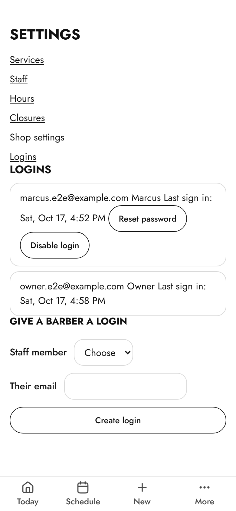

## Uploading photos and writing alt text

1. Tap **More**, **Photos**.
2. **Hero** is the big photo on the home page. **Chairs** is each barber's
   portrait. **Gallery** is the work.
3. Tap **Choose a photo**, pick one from your camera roll, then write what is
   in the photo in **Describe the photo**. This is read aloud to people who
   cannot see it and shows if the photo fails to load. "Marcus, skin fade with
   a hard part" is better than "photo".
4. Tap **Upload photo**. The phone shrinks it before sending, so big photos
   are fine.
5. The first photo in a list is the one shown on the site. Use **Up** and
   **Down** to reorder. **Remove** takes it off the site.

Portraits look best taller than wide. The hero looks best wide, with the
person off to one side so the words fit over it.

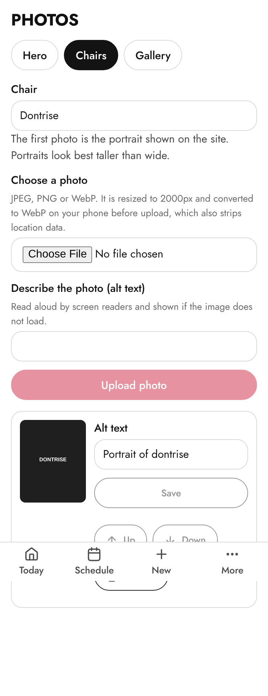

## Turning the light or dark theme on

Tap **More**, **Account**, then under **Appearance** choose **System** (follows
your phone), **Light** or **Dark**. The public website has the same switch at
the top right of every page.

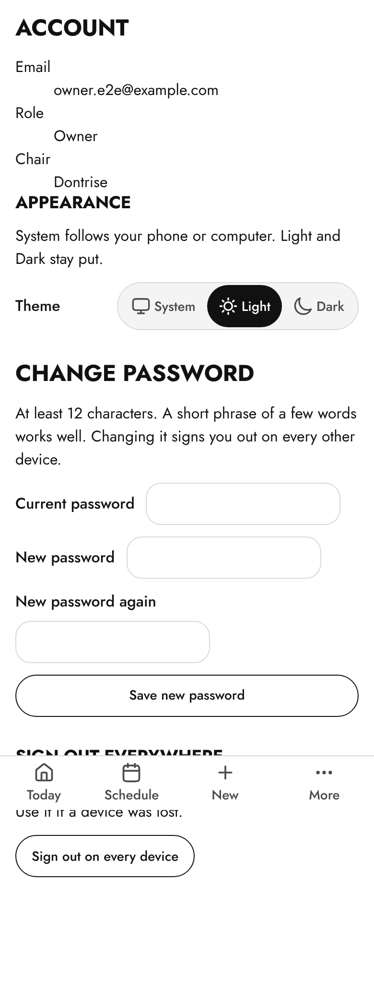

## Who to call when something is wrong

Visualize: **contact@visualizeclients.com**

Send a screenshot and what you were doing. If a customer saw an error, the
error message has a code and a request id; include those.

If the website is down and people cannot book, you can still take bookings in
the dashboard (**New**) and by phone. The website tells customers to call the
shop while it is down.
