# Owner guide

For Dontrise. This is how to run the shop's website and bookings. Everything
happens at **yoursite/admin** (the address Visualize gave you). It works on a
phone, on the shop tablet and on a laptop; the pictures below are the laptop view
unless they say phone or tablet. If something looks wrong, the last section says
who to call.

The screens in this guide were taken from the demo before your real team,
prices and photos were loaded, so they show sample barbers and clients. Your
own team and clients show in their place.

## 1. Sign in

1. Open **yoursite/admin**.
2. Type your email and password and tap **Sign in**.
3. The first time, the site asks you to choose a new password: 12 characters or
   more, not a word people could guess.

Barbers do not sign in here. They use their own page, **yoursite/team** (see
section 11 and the Barber guide).

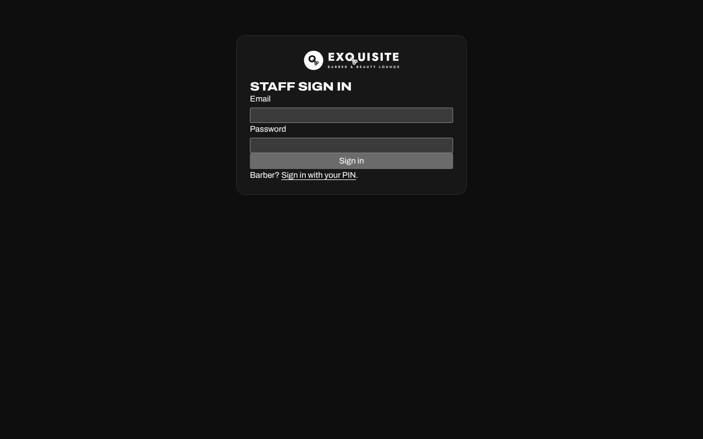

## 2. Two sides: Shop and Website

The top bar has a switch, **Shop | Website**. Shop is the day: Today, Bookings,
Schedule, Clients and Team. Website is everything customers see, in one editor
(section 12). The switch remembers which side you used last on each device.

The top bar also holds the search box, the shop clock, **Check in** (section 8) and
the red **New booking** button. Your initial at the right opens Settings and Sign out.

## 3. Today, the floor

**Shop, Today** is the floor: one card per chair. A card is red while a cut is going
(with a bar filling up and the time it should end), white when the chair is free,
grey when the barber is off today. On the right, the walk-in line, **Coming up** for
the next hour and **Today so far**.

- **Coming up**: tap **Arrived** when a client walks in, **Start** when they sit down,
  **No show** if they never came. **Move** opens the booking to give it to another
  chair.
- A card with a cut going shows **Done**. Finishing early gives the rest of the time
  back to the chair, so the next walk-in can start right away.
- The floor refreshes itself every 30 seconds while the page is open.

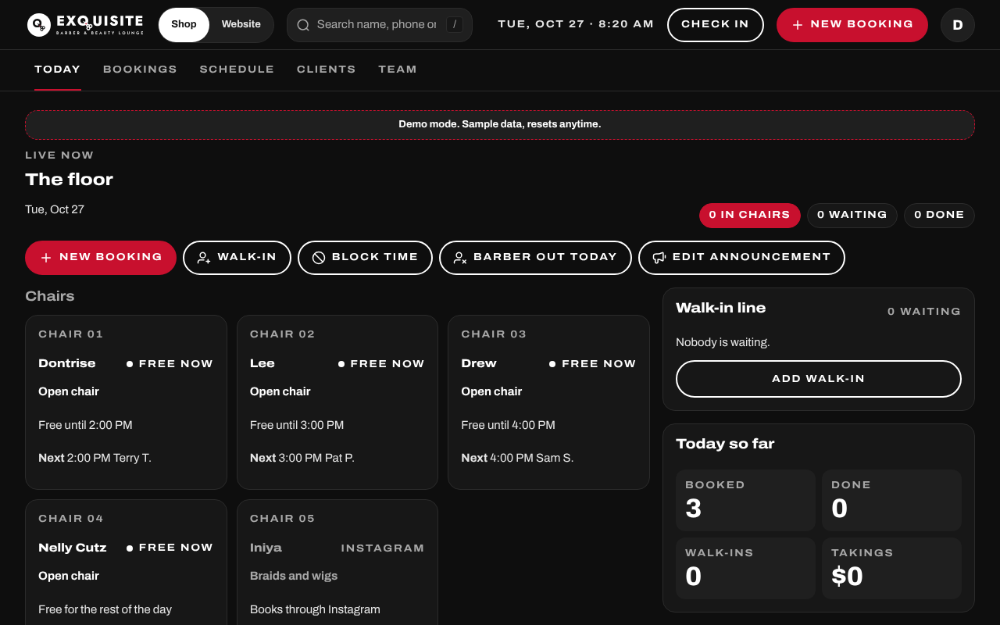

## 4. The walk-in line

The **Walk-in line** panel on Today lists everyone waiting, numbered, with the
services, the chair they asked for (or First available), how long they have waited
and about when a chair frees up.

- **Seat** puts them in their chair this minute. It only works while the chair is
  free for the full cut; otherwise it says so with the time.
- A free chair card shows **Seat walk-in #1** for the first person it can take.
- **Move** picks another chair (each with its own estimate). The arrows reorder.
  **Left** takes them out of the line.
- **Add walk-in** opens New booking with **Now** already picked.

The line only takes people while the shop is open and the barber is in. If a barber
goes off while someone is waiting for them, the card says **Drew is off. Move or
mark left** in red; nobody is dropped on their own.

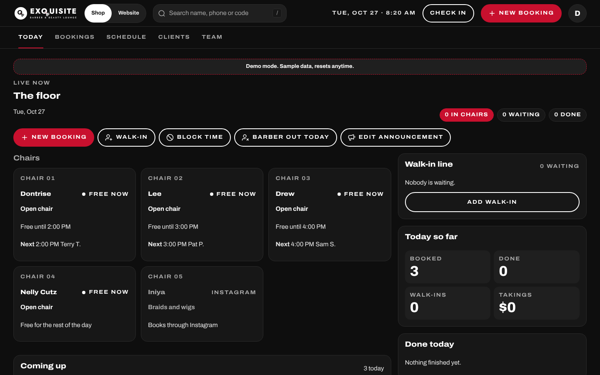

## 5. New booking, Now or later

Tap the red **New booking** (top bar) or **Add walk-in** (the line). The full-screen
flow has five steps, with a summary on the right and one red button:

1. **Service**: tap one or more. The total updates.
2. **Barber**: each chair with its own exact price and whether it is free now, or
   **First available**. A barber who does not do the pick is greyed.
3. **Time**: **Now** sits first. Now books this minute if the chair is free, else the
   client joins the line. Outside the hours the tile says why ("The shop is closed
   right now. Opens Tue 10 AM", "Drew is off today", "Drew is done for the day") and
   cannot be picked. Under Now, one row of days to scroll (each with its open count,
   closed days greyed) and the times for the picked day grouped Morning, Afternoon
   and Evening.
4. **Client**: **Find a client** searches past clients by name or phone; or type the
   name and mobile number. Email is optional; a booking with an email gets the
   confirmation.
5. **Confirm**: the summary and the exact price. The ticket says **Booked: Tue 3:30
   with Drew** or **Walk-in #2 for Drew, about 25 min**. **Done** closes; **New
   booking** starts another.

The X asks **Discard this booking?** if you have typed anything. If a time is taken
while you are typing, the flow says so and offers the next open times.

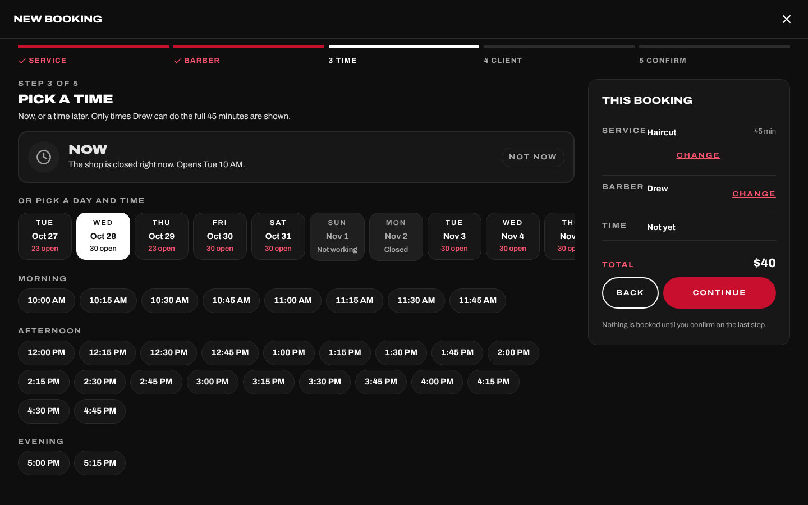

## 6. Find and change a booking

Type a name, a phone number or a reference code in the search box; the matches
list bookings and clients. Tap one to open its panel: the details, notes, the
emails sent, and the buttons.

- **Reschedule** opens the flow on the Time step. **Move to another barber** opens
  it on the Barber step with the new barber's price. Both keep the same rules as a
  new booking and email the client.
- **Cancel** asks for a reason and whether to email the client.
- **Bookings** (the tab) lists everything by day with filters, and under the list
  the week chart and the latest activity.

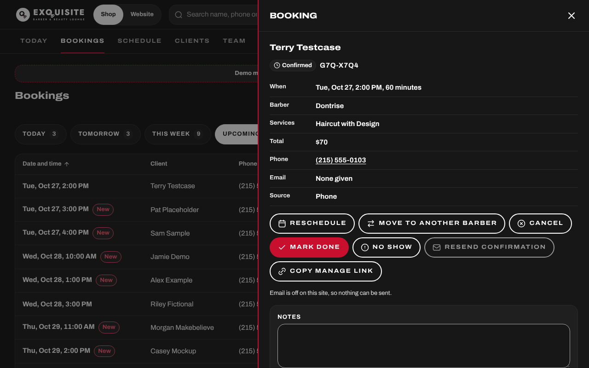

## 7. Schedule, blocking time, and when a barber is out

**Schedule** shows the day or the week per chair. Tap an empty stretch to **Block
time** (lunch, a break, a day off) or add extra hours. When a barber marks
themselves out (from their phone), a red strip appears on Today and Bookings with
their clients: open it and decide, client by client, **Move** to another chair or
**Cancel** with an email. Nothing is cancelled until you decide.

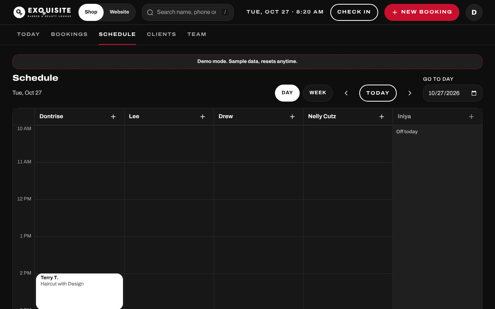

## 8. The check-in tablet

**Check in** (top bar) opens the full-screen tablet page. Leave it open on the desk,
sideways or upright; it keeps the screen awake where the tablet allows it.

- **Walk in** (red, half the screen) runs the booking flow with big tiles. The end
  screen says **Head to chair 3 for Drew** or **You're #2 for Drew, about 25 min**,
  then goes back on its own after six seconds.
- **I have an appointment**: the client types their name or the last 4 of their
  phone and sees today's bookings as big tiles (time, first name and last initial,
  barber). One tap marks them arrived; it shows up on Today at once. The screen never
  shows anyone's phone, email or full name.
- **Chairs right now** at the bottom shows each barber: Free now, Free about 2:50, or
  Off today.
- **Exit** returns to Today. This screen runs on your login, so do not leave it out for
  clients: for the front desk, pair a locked tablet (section 8b).

When the shop is closed, or nobody is in, Walk in is greyed and says why.

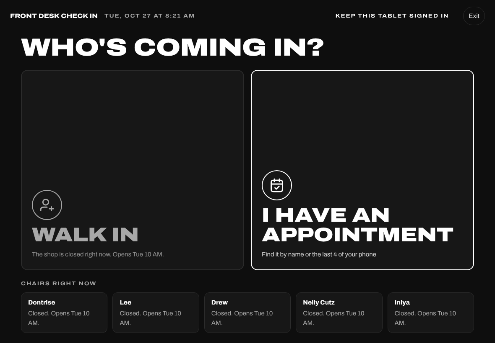

## 8b. The front desk tablet

The locked tablet lives at **yoursite/checkin**. Clients can walk in, check in for an
appointment and see who is in. They cannot reach anything else: no dashboard, no prices to
change, no client list. It replaces leaving the check in screen open on your own login.

**Pair it.** In **Settings, Check in tablets**, give the tablet a name ("Front desk") and a six
digit **exit PIN** that only you know, then tap **Get a pairing code**. On the tablet open
**yoursite/checkin** and type the code on the pad within ten minutes. It works once. Five wrong
codes lock pairing for 15 minutes.

**The board.** Under Walk in and I have an appointment, **Who's in today** shows one tile per
barber working today: **Free now** (white), **With a client, free about 2:45** (red), **On a break
until 3:00**, **Starts at 12 PM** or **Done for the day** (grey), and "2 waiting" when people are
in their line. Barbers off today sit in one line at the bottom. When the shop is closed the board
says "Closed now. Opens Wed 10 AM" and Walk in is greyed. It refreshes itself every 20 seconds.

**Leaving the locked screen.** There is no Exit. Press and hold the logo at the top left for three
seconds, type the exit PIN, and a small menu offers **Reload**, **Unpair this tablet** and
**Close**. Five wrong PINs lock the exit for 15 minutes. After 45 seconds without a tap, any flow
goes back to the start on its own and clears what was typed.

**A lost tablet.** In **Settings, Check in tablets**, tap **Unpair** next to it. It goes back to
its pairing screen at once, wherever it is. The list shows when each tablet was paired and last
used.

**Pin the browser so nobody can leave it.** On an iPad: Settings, Accessibility, Guided Access,
turn it on and set a passcode; open the tablet page in Safari, then triple-click the side button
and tap Start. Triple-click again and type the passcode to end it. On an Android tablet: Settings,
Security, Screen pinning (on some tablets "App pinning"), turn it on; open the page in Chrome,
open the recent apps view, tap the app's icon and choose Pin.

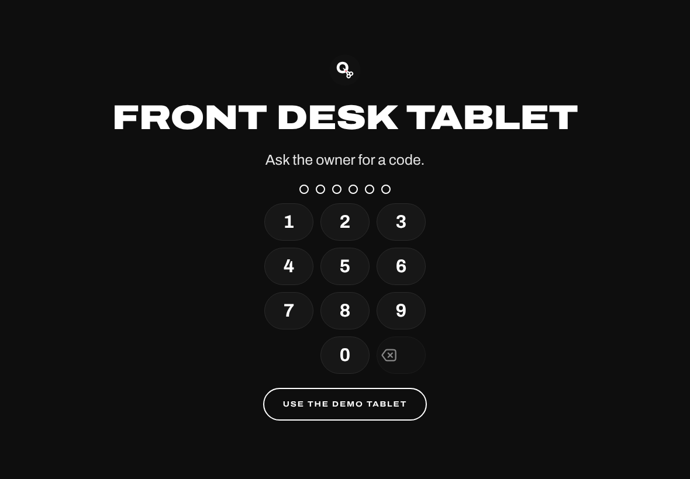

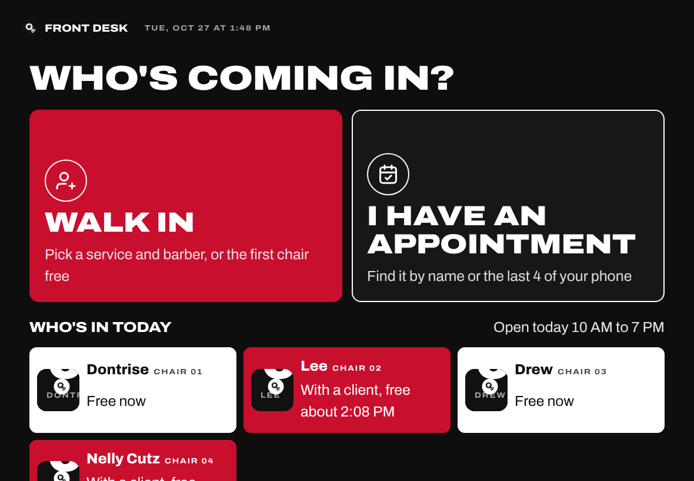

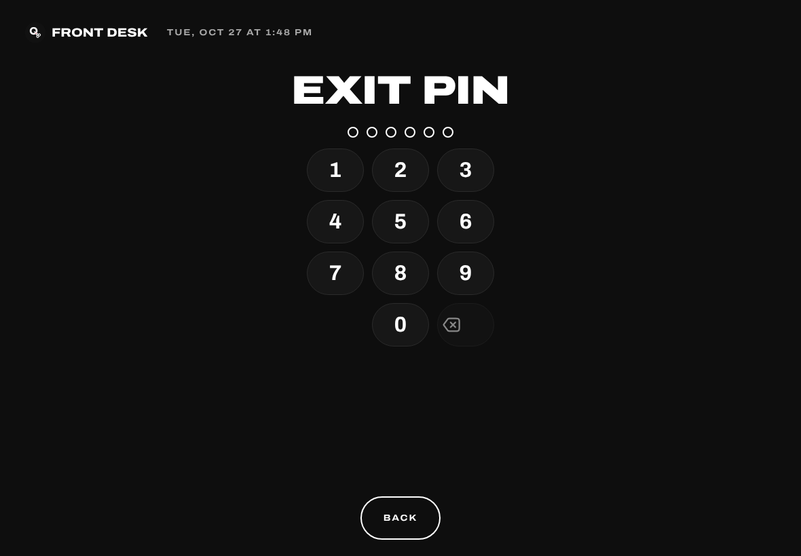

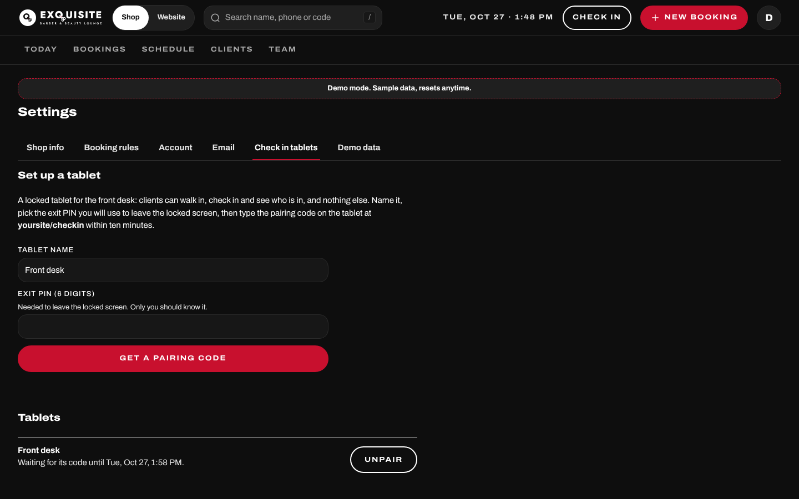

## 9. Clients

**Clients** lists everyone who has booked, by phone number, with visits and spend.
Open one to see their bookings and keep a note (only you and the barbers see notes).

## 10. Team

**Team** has one row per chair: name, photo, **In** or **Off today**, their next
booking. Open a barber for their tabs: Profile (specialty, bio, Instagram, the
portrait: the first photo is the one on the site), Services, Prices (their own
prices over the shop's), Working hours, Time off and Access (the setup link, Reset
PIN, unlock). Turning a barber **Off** for the day asks what to do with their
clients.

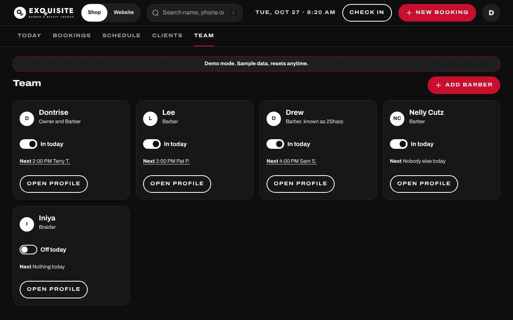

## 11. Barber logins

Each barber signs in at **yoursite/team** with a six digit PIN: they tap their card,
then the PIN. You never see a PIN. From **Access** you send the first setup link
(it works once, for 72 hours), **Reset PIN** when one is forgotten, and unlock after
five wrong tries. A barber sees only their own chair: their day, Add booking (with
Now), Start cut, Done and No show, Out for the day, the week, time off and Me. The
Barber guide covers their side.

## 12. The Website editor

The **Website** side is one screen. The list on the left has every section with a
status tag; the middle is a live preview of the home page top; the right is the
panel for the section. On a phone the list and the panel stack, and **Preview**
opens the preview full screen.

- **Announcement bar**: on or off, the text, a link and an end date.
- **Top of page**: the photo (upload a new one), the **Headline** (up to 48
  characters), the **Word in red** (one of the headline's words) and the **Line
  under it**. The preview follows as you type; **Save and publish** puts it live
  and the bar says **Saved. Live on the site now**. **Undo changes** goes back to
  what is saved.
- **Launch offer**: the "$10 off your first online booking" from the ads. **Offer on**
  switches it; the amount and the minimum price are whole dollars; **Words on the site** is the
  small red line on the home page and the Book page; **First day** and **Last day** are optional
  (after the last day it switches itself off). The line **Used 12 times, $120 off** counts the
  bookings that stand. The site gives it on its own: online bookings only, once per phone number,
  only when the price reaches the minimum. Bookings you or a barber add, walk-ins and check-ins
  never get it. A booking with it shows **$45, $10 off online** on Today and in its panel; the
  client's email shows the line and the total after it. Cancelling frees the phone number for a
  later first booking; moving or rescheduling keeps the offer.
- **The work** and **Gallery**: upload, caption, order, credit a photo to a barber,
  and mark the six that show on Home.
- **Reviews**, **Hours**, **Services and prices** (with each barber's own prices) and
  **Team**: the same editors as before, inside the panel.
- **Visit, map and contact**: the phone, the email (it shows publicly only once it
  is no longer the stand-in), the parking line and the **Good to know** lines.

**Phone** and **Computer** switch the preview size. The section you are editing has
a red outline and an **Editing** tag. Leaving a section with unsaved changes asks
first. If the same thing was saved from another tab or phone in the meantime, the
save is refused with **Changed somewhere else, reload**: reload and try again.

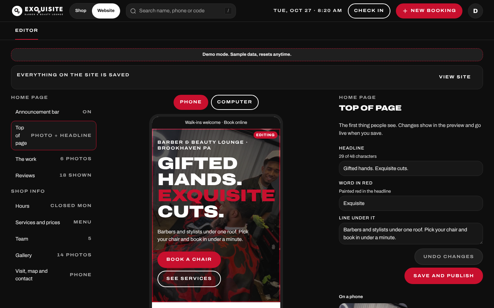

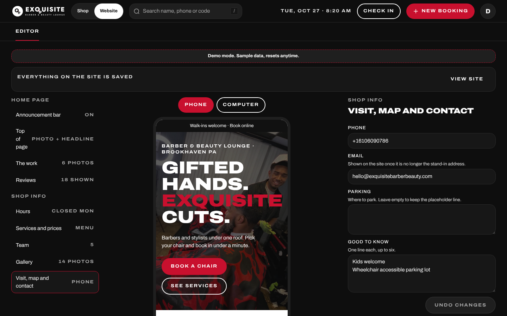

## 13. Settings

Your initial, then **Settings**: Shop info (name, address, phone, email, Instagram),
Booking rules (how soon and how far ahead people can book, the cancel time, the
cleanup gap, email required or not), the emails that get alerts, and your account
(email, password, sign out everywhere).

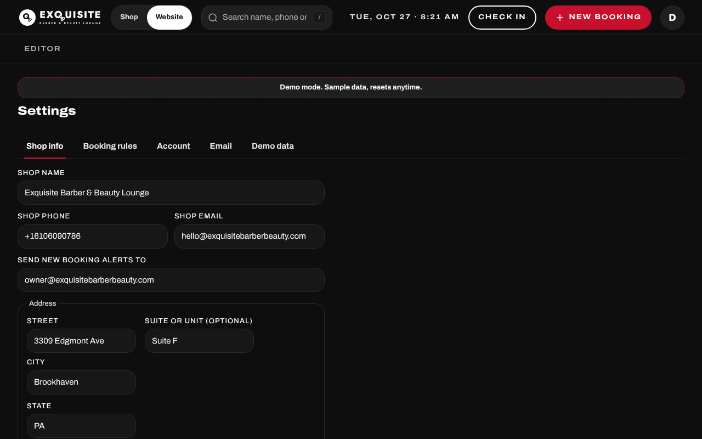

## 14. Check before the real launch

The address, phone, hours, team, services, prices, reviews and photos come from
the shop's Google profile, your Squire menu, Drew's and Nelly's theCut menus and
Instagram. A few things were not public, so they hold a stand-in until you
confirm them:

- Lee's services, prices and profile text. He has no public menu, so he has the
  shop prices and no profile text for now. Change them in Team, Lee (Services,
  Prices, Profile).
- Your, Lee's and Nelly's working hours (the shop hours for now; Drew's are his
  theCut hours). Change them in Team, Working hours.
- How soon someone can book (1 hour ahead), how far ahead (30 days) and the
  cancel time (2 hours). Change them in Settings, Booking rules.
- The shop email and the email that gets new booking alerts (Settings, Shop
  info), the parking line (Website, Visit), and the email you sign in with
  (Settings, Account).
- The chair numbers (1 to 5 for now), the 10 minute cleanup gap after each
  appointment, the reply-to address on emails and the website address. Send
  these to Visualize.

## 15. Who to call when something is wrong

Tell Visualize first: **contact@visualizeclients.com**. Include what you tapped,
what you expected and what happened, and a screenshot if you can. If the site is
down, customers see a notice with the shop's phone number, so they can still call.

On the Demo site only: a notice says "This is a demo" the first time someone
opens it in a browser session. It never shows on the real site.
